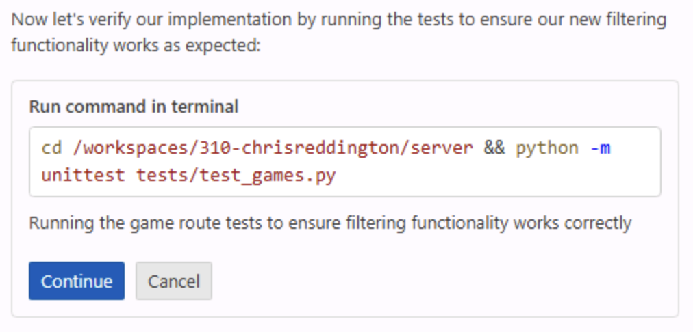

即使是简单的应用更新，通常也涉及多个文件，以及运行测试等操作。开发者需要定位相关文件、进行修改、运行测试、调试、找出遗漏文件并再次修改，过程可能不断重复。

Copilot 智能体模式可以帮助处理这些工作。

Copilot 智能体模式可以在 IDE 中更自主地工作。它会探索项目结构、执行必要更新、运行测试等任务，并自动修复发现的问题。现在使用智能体模式为网站添加新功能。

> [!NOTE]
> 智能体模式和云智能体名称相似，但适用于不同场景。智能体模式在 IDE 中执行任务，适合快速反馈和交互。云智能体则像团队成员一样异步工作，通过议题和拉取请求与你协作。

本练习将介绍如何：

- 让 Copilot 智能体模式探索项目、查找相关文件并协调修改。
- 使用 GitHub Copilot 智能体模式跨 UI 和数据层实现新功能。
- 在将代码合并到代码库之前审查 Copilot 智能体模式生成的变更和测试。

## 场景

游戏列表不断变长，用户需要按类别和发行商筛选。上一练习已添加发行商辅助函数，现在将使用 Copilot 智能体模式完成剩余的数据层、UI 和测试工作。

## 运行 Tailspin Toys 网站

更改之前，先查看网站当前功能。

此网站是一个以开发者为主题的棋盘游戏众筹平台，可列出游戏并显示其详情。它是一个单体 Astro 应用，构建时将页面渲染为静态 HTML。页面通过 frontmatter 使用 Drizzle ORM 直接查询本地 SQLite 数据库，没有单独的后端 API 或客户端 UI 框架。可复用的数据访问辅助函数位于 `src/lib/`，交互功能由使用标准 DOM API 的小型 Astro `<script>` 实现。

### 启动网站

项目提供了 `npm run dev` 任务，用于启动单体 Astro 开发服务器。按以下步骤在 GitHub Codespace 中运行：

1. 返回 Codespace。上一练习结束后应已位于 `main`。
2. 按 <kbd>Control</kbd>+<kbd>\`</kbd>（Mac）或 <kbd>Ctrl</kbd>+<kbd>\`</kbd>（Windows/Linux），在 Codespace 中打开新终端。
3. 返回 `main` 并为筛选功能创建新分支：

   ```bash
   git checkout main
   git pull
   git checkout -b filtering-vscode
   ```

4. 启动网站：

   ```bash
   npm run dev
   ```

   Astro 开发服务器准备就绪后，会显示类似以下内容的横幅：

   ```bash
   🚀 Tailspin Toys is ready!
      Astro server: http://localhost:4321
      Press Ctrl-C to stop.
   ```

> [!NOTE]
> 如果弹出对话框，询问是否打开 `http://localhost:4321` 的浏览器窗口，请选择 **x** 将其关闭。

5. 按住 <kbd>Command</kbd>（Mac）或 <kbd>Ctrl</kbd>（Windows/Linux），然后在终端中选择 Astro 服务器地址 `http://localhost:4321`，打开网站。

> [!NOTE]
> 在 Codespace 中，从终端选择 localhost URL 会自动转到 `https://<your-codespace-name>-4321.app.github.dev/`。这是连接到 Codespace 网站服务器的专用隧道。

### 探索网站

网站启动后，可以探索以下主要功能：

- **主页**：显示游戏列表，包括标题、图片和描述。
- **游戏详情页**：选择游戏后会打开详情页，其中包含标题、描述、发行商和类别等信息。

## 使用 Copilot 探索待办列表

> [!TIP]
> **打开 Copilot Chat**
>
> 开始以下练习前，返回 Codespace，打开 Copilot Chat 面板并选择 **New Chat**，开始全新对话。模式和模型的选择因练习而异；每个步骤会在需要时说明。

网站的初始实现已可正常运行，但我们想添加更多功能。先查看待办列表。根据模板创建项目时，系统已自动创建一组议题；让 GitHub Copilot 显示这些议题。

1. 在 Chat 视图的智能体下拉列表中选择 **Agent**。Agent 智能体会自主规划并跨文件实现变更、运行终端命令和调用工具。

   

2. 从可用模型列表中选择 **Claude Sonnet 4.5**。

> [!CAUTION]
> 研讨会作者并未推荐任何特定模型。编写研讨会时使用了 Claude Sonnet 4.5，因此示例使用该模型，以便尽量保持一致的学习体验。LLM 具有概率性，收到的建议可能与示例不同，这是正常且符合预期的。

> [!NOTE]
> 由于 LLM 具有概率性，Copilot 可能会使用不同的 MCP 命令，但仍应能完成任务。

3. 向 Copilot 发送以下提示，查看议题待办列表：

   ```plaintext
   Please show me the backlog of items from my GitHub repository. Help me prioritize them based on those which will be most useful to the user.
   ```

4. 选择 **Continue** 以运行列出所有议题的命令。
5. 查看生成的议题列表。

Copilot 还会根据它认为对用户最有用的程度为议题排序。

## 查看指令文件

让智能体生成代码之前，先查看将用于提供项目上下文的指令文件。项目的[用户界面 (UI)](https://github.com/github-samples/tailspin-toys/blob/main/.github/instructions/ui.instructions.md) 文件包含向网站添加功能的指导。

1. 在 Codespace 中打开 `.github/instructions/ui.instructions.md`。
2. 查看整体指南，包括：
   - 架构概述。
   - 组件设计、可测试性和无障碍访问原则。
   - 指向各类文件专用指令的链接，包括 Astro、Tailwind CSS 和 Drizzle。

> [!TIP]
> 指令文件可以引用其他指令文件和项目文件。路径相对于指令文件所在位置，因此可以复用内容、拆分复杂指导，并提供示例和模板。

## 实现筛选功能

要完成筛选，至少需要对应用做三项修改：

- 添加或完善数据层 (`src/lib/`) 中剩余的筛选逻辑。
- 添加或更新筛选行为测试。
- 更新游戏列表页，添加筛选 UI。

合并前还需运行测试并确保通过。让 Copilot 智能体模式完成这些工作：

1. 可以继续当前 Copilot 对话，也可以选择 **New Chat** 开始新对话。
2. 选择 **Add Context**、**Instructions**，然后选择 `ui` 指令文件。

   

3. 确认 Chat 视图的智能体下拉列表中仍选择 **Agent**。

   

4. 确认仍选择 **Claude Sonnet 4.5**。
5. 使用待办列表中相关议题的要求，发送以下提示：

   ```plaintext
   Please update the site to include filtering by publisher and category based on the requirements from the related GitHub issue in the backlog. A publishers helper already exists from the previous exercise, so preserve and refine that work as needed while completing the remaining data-layer, UI, and tests. Ensure all tests are passing before completion. The server is already running, so you do not need to start it up.
   ```

6. 观察 Copilot 如何探索项目并查找相关文件，包括数据层辅助函数、UI 和测试，然后修改文件并运行测试。

   

> [!NOTE]
> Copilot 会探索项目、修改文件并运行测试。根据任务复杂度和代码库规模，此过程可能需要几分钟。过程中代码编辑器可能会出现 **Keep** 和 **Undo** 按钮。工作完成后，所有变更都会显示 **Keep** 或 **Undo**，无需在处理中途选择。

7. 按 Copilot 的提示选择 **Continue** 以运行测试。

   

8. 处理中可能会暂停，测试也可能暂时失败。这是正常的。Copilot 会在代码生成和测试之间迭代，直到任务完成且未检测到错误。

   

9. 检查生成的代码是否存在潜在问题。

> [!CAUTION]
> 始终需要审查 Copilot 或其他 AI 工具生成的代码。

10. 返回正在运行的网站浏览器，探索新功能。
11. 确认功能正常并审查代码后，在 Copilot Chat 窗口中选择 **Keep**。

## 总结和后续步骤

恭喜！本练习介绍了如何使用 GitHub Copilot 智能体模式为 Tailspin Toys 网站添加功能。你了解了如何：

- 使用 GitHub Copilot 智能体模式跨 UI 和数据层实现新功能。
- 让 Copilot 智能体模式探索项目、查找相关文件并协调修改。
- 在将代码合并到代码库之前审查 Copilot 智能体模式生成的变更和测试。

接下来，[使用 Playwright MCP 服务器测试功能][next-lesson]，然后创建拉取请求。

### 扩展探索练习 – 实现分页

游戏列表不断扩大后，需要实现分页。运用本练习所学知识，让 Copilot 更新网站并实现分页。可以考虑：

- 遵循现有最佳实践，包括使用已有指令文件。
- 决定分页的实现方式，例如是否允许用户选择每页大小，还是使用固定大小。
- 编写提示时提供所需指导。
- 通过迭代、请求修改和补充上下文来完善 Copilot 的实现。这是使用 Copilot 的正常工作流程。

## 资源

- [Copilot ask、edit 和 agent 模式：功能及适用场景][choose-mode]
- [VS Code 中的智能体模式][vs-code-agent-mode]

[previous-lesson]: ../1-custom-instructions/
[next-lesson]: ../3-mcp/
[choose-mode]: https://github.blog/ai-and-ml/github-copilot/copilot-ask-edit-and-agent-modes-what-they-do-and-when-to-use-them/
[vs-code-agent-mode]: https://code.visualstudio.com/docs/copilot/chat/chat-agent-mode
